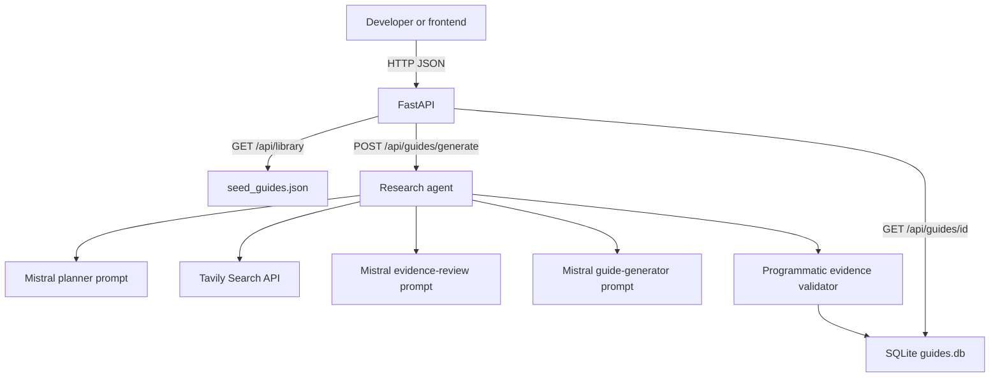

# OAuth Launchpad

OAuth Launchpad is a research-agent backend for developers who need to connect an external app to an AI agent. You type an application name or website. The backend searches the public web, reasons over the evidence, and returns a structured OAuth setup guide.

The guide is meant to be honest: it tells you where to start, what you must do yourself, what remains unknown, and which official pages support the steps. It does **not** sign in to the provider, create an OAuth app, or handle secrets for you.

This repository is the Python API. A frontend can later render the JSON guides.

## What this product does

- Accepts an app name or website plus an optional integration goal.
- Plans a short web investigation with Mistral.
- Searches with Tavily (no arbitrary user-URL fetching, so this API is not an SSRF proxy).
- Reviews evidence gaps and may run at most one extra search round.
- Generates a validated OAuth setup guide.
- Stores generated guides in SQLite so you can retrieve them by ID.
- Serves a small built-in library for GitHub, Slack, and Google Calendar even when API keys are missing.

Live generation requires working Mistral and Tavily keys. The starter library does not.

## System architecture



## Research-agent workflow in plain English

1. **Understand the request.** The backend trims the input. If you pasted a URL, it extracts the hostname without fetching that URL. Private or loopback hosts are rejected.
2. **Plan.** Mistral returns a small JSON plan: likely product name, candidate domain, 3–5 search queries, and uncertainties. It is not allowed to invent provider facts or pretend it already searched.
3. **Search.** Tavily runs those queries. Results are deduplicated by URL, classified as official / secondary / uncertain by domain (not by a flashy title), and truncated before they go back to the model.
4. **Review gaps.** A second Mistral prompt checks whether creation steps, redirects, scopes, publishing, and verification are covered. It may suggest at most two extra searches. The backend runs those at most once.
5. **Write the guide.** A third prompt produces JSON. Webpage text is wrapped as untrusted data so prompt injection in search snippets cannot override the rules.
6. **Validate.** Pydantic checks the schema. Invalid JSON gets one repair attempt. Citations that do not match retrieved sources are dropped and marked uncertain. A guide cannot claim it was tested unless a real test attempt was recorded (this backend never records one).
7. **Save and return.** The guide gets a stable ID and timestamp, is stored in SQLite, and is returned to the caller.

If keys are missing, Tavily returns nothing useful, or the app cannot be identified, the API returns a clear error. It does not quietly invent a successful guide.

## Prerequisites

- Windows 10 or later
- Python 3.11 or newer (this project was implemented against Python 3.11)
- A [Mistral](https://console.mistral.ai/) API key
- A [Tavily](https://tavily.com/) API key

You do **not** need API keys to browse the library or run the automated tests.

## Windows PowerShell setup

```powershell
cd D:\Documents\Product\assignments\Composio_OAuth

python --version
python -m venv .venv
.\.venv\Scripts\Activate.ps1

python -m pip install --upgrade pip
pip install -r requirements.txt

Copy-Item .env.example .env
notepad .env
```

If PowerShell blocks the virtual environment script, run this once for your user account, then activate again:

```powershell
Set-ExecutionPolicy -Scope CurrentUser RemoteSigned
```

## Configure `.env`

Open `.env` and fill in:

```
MISTRAL_API_KEY=your_mistral_key
MISTRAL_MODEL=mistral-small-latest
TAVILY_API_KEY=your_tavily_key
CORS_ORIGINS=http://localhost:3000,http://localhost:5173
```

Optional tuning (all have defaults):

```
TAVILY_SEARCH_DEPTH=basic
TAVILY_MAX_RESULTS=5
TAVILY_TIMEOUT_SECONDS=30
MISTRAL_TIMEOUT_SECONDS=45
HTTP_MAX_ATTEMPTS=3
DATABASE_PATH=data\guides.db
```

Never commit `.env`. Never put keys in prompts, logs, or API responses. The backend reads keys only from the environment.

## Run the API locally

```powershell
.\.venv\Scripts\Activate.ps1
uvicorn app.main:app --reload --port 8000
```

- Health check: http://127.0.0.1:8000/health
- Swagger UI: http://127.0.0.1:8000/docs
- OpenAPI JSON: http://127.0.0.1:8000/openapi.json

CORS allows only the origins listed in `CORS_ORIGINS` (local frontend ports by default), not `*`.

## Run tests

The automated tests **mock** Tavily and Mistral. Passing tests means the orchestration, validation, and HTTP layer work. They are **not** evidence that GitHub, Slack, Google, Tavily, or Mistral were exercised live.

```powershell
.\.venv\Scripts\Activate.ps1
pytest
```

## Example API requests

Health:

```powershell
Invoke-RestMethod http://127.0.0.1:8000/health
```

Library (works without API keys):

```powershell
Invoke-RestMethod http://127.0.0.1:8000/api/library
```

Generate a guide (needs live keys; this calls Mistral and Tavily):

```powershell
$body = @{
  app_name_or_url = "linear.app"
  integration_goal = "Allow an AI agent to create and update issues"
  requested_scopes = @()
} | ConvertTo-Json

$result = Invoke-RestMethod `
  -Uri http://127.0.0.1:8000/api/guides/generate `
  -Method Post `
  -ContentType "application/json" `
  -Body $body

$result.status
$result.guide.id
$result.guide.summary
```

Retrieve that guide later:

```powershell
Invoke-RestMethod "http://127.0.0.1:8000/api/guides/$($result.guide.id)"
```

Using curl.exe if you prefer:

```powershell
curl.exe http://127.0.0.1:8000/health
curl.exe -X POST http://127.0.0.1:8000/api/guides/generate -H "Content-Type: application/json" -d "{\"app_name_or_url\":\"linear.app\",\"integration_goal\":\"Allow an AI agent to create and update issues\",\"requested_scopes\":[]}"
```

## What is live vs mocked

| Action | Live services? |
| --- | --- |
| `GET /health` | No |
| `GET /api/library` | No; reads `data/seed_guides.json` |
| `pytest` | No; Tavily and Mistral are mocked |
| `POST /api/guides/generate` | Yes; Mistral Chat Completions and Tavily Search |
| `GET /api/guides/{id}` | No extra APIs; reads SQLite |

## Known limitations

- The agent reads search snippets. It does not log into developer consoles or complete OAuth.
- Approval waits are allowed to be `unknown`, `documented`, `provider_dependent`, or `none_indicated`. If a provider does not publish a timeline in the retrieved sources, the guide must leave it unknown. Do not treat an estimate as a measured wait.
- Source citations support a step; they do not prove every detail of that step.
- Library cards for GitHub, Slack, and Google Calendar are **source review only**. They were not produced by creating real OAuth apps in those products.
- Google verification timelines, Slack App Directory review, and GitHub Marketplace listing were not human-tested here. Check the linked official docs before promising a date to stakeholders.
- Direct fetching of user-supplied URLs is intentionally disabled.

## Using a generated guide in a frontend

`POST /api/guides/generate` returns JSON with `status`, `message`, `guide`, and `research_activity`.

Useful `guide` fields for UI:

- `summary`, `difficulty`, `difficulty_reason`, `time_estimate`
- `prerequisites`, `steps` (owner, `human_handoff`, `evidence_status`)
- `blockers`, `unknowns`, `next_action`
- `sources` (open the exact URLs)
- `testing_record` (expect `tested: false` unless you add a real test harness later)
- `research_activity` (audit of searches and model calls, not chain-of-thought)

Store `guide.id` and reload it with `GET /api/guides/{guide_id}` after a page refresh.

## Validation notes (implementation-time)

These items were **not** verified by a human completing provider setup. They should be re-checked against current official docs before a launch decision:

- GitHub App vs OAuth App recommendation for a given agent architecture
- Slack App Directory / distribution review, if the app will be public
- Google OAuth verification and any Calendar scope sensitivity for production users outside a test audience
- Exact current scope names for any provider

Automated tests in this repo are mocked. Live Mistral and Tavily calls succeed only when you run generate with valid keys.
